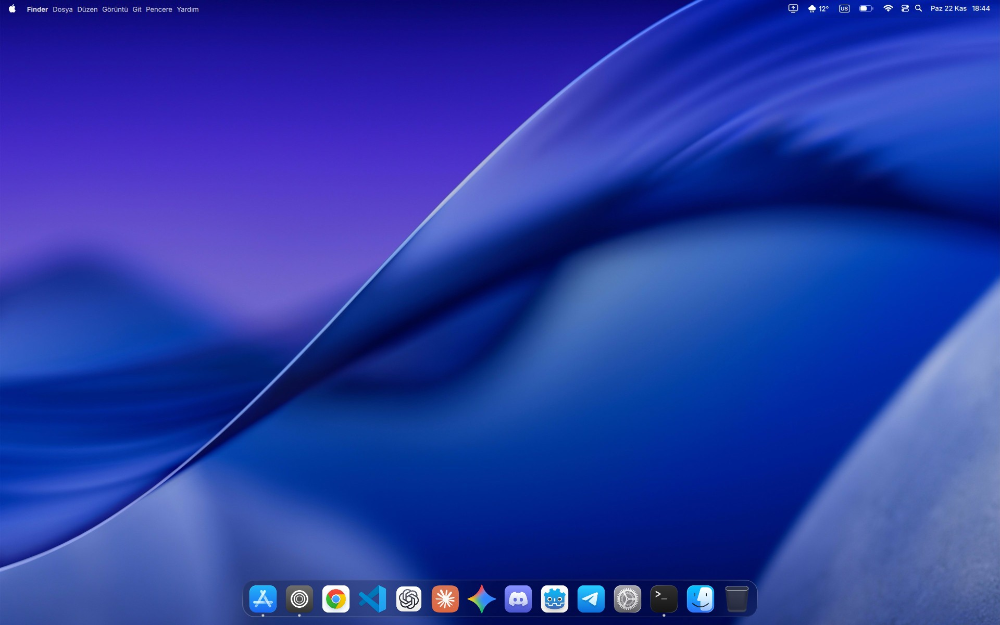
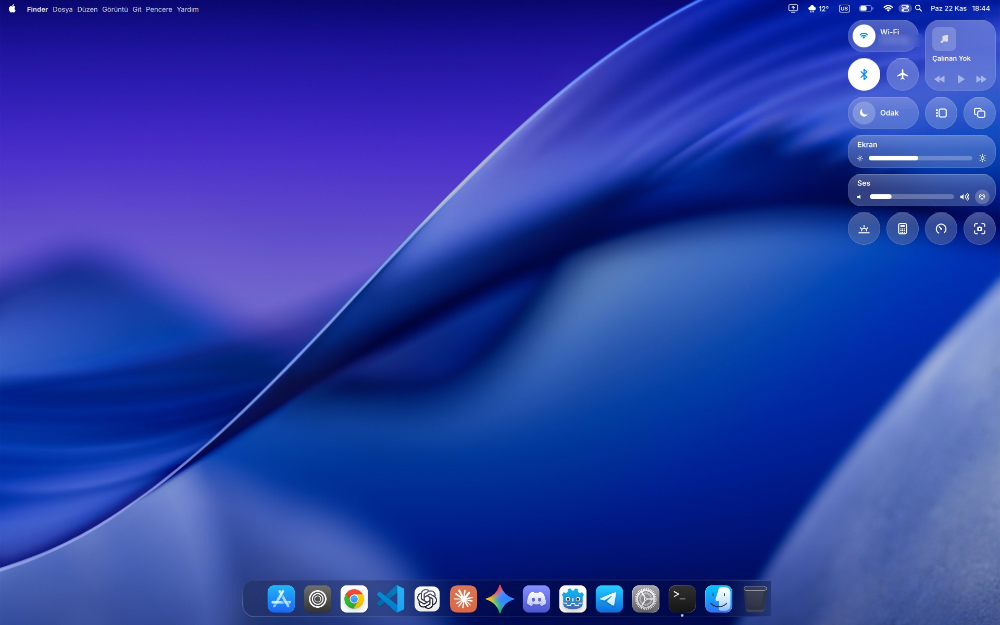
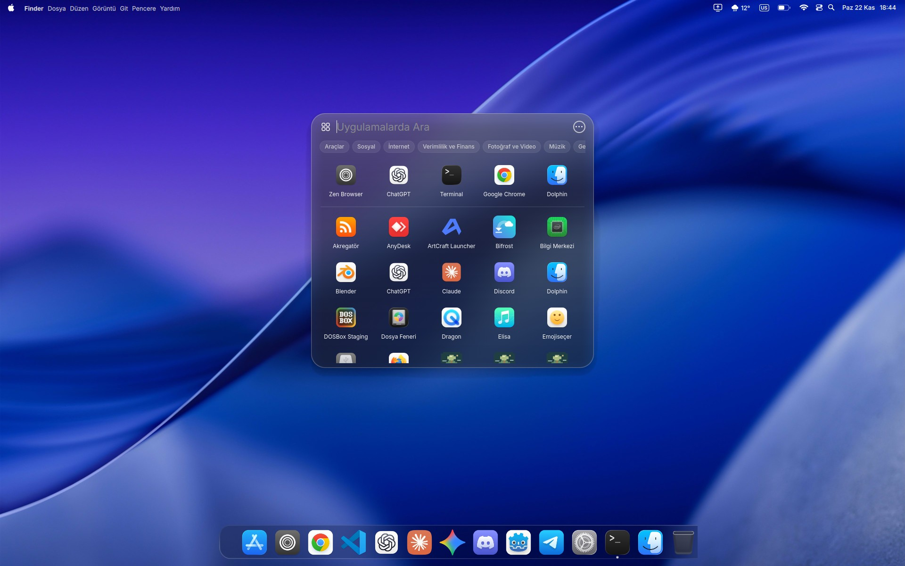
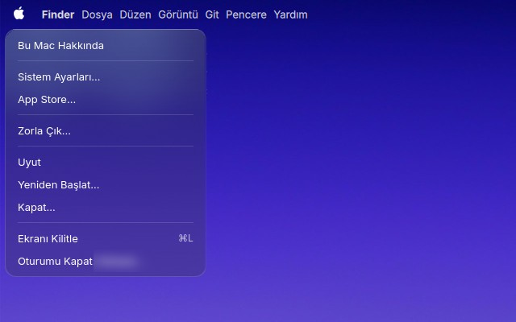
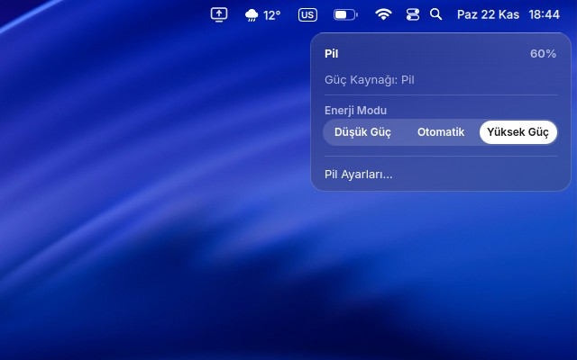
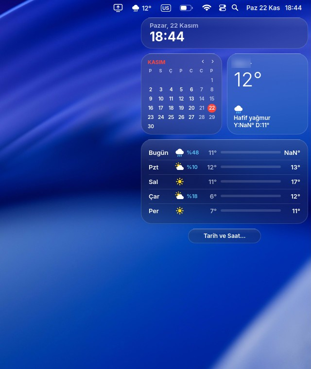

# kde-tahoe

A macOS Tahoe–style desktop for **KDE Plasma 6 (Wayland)** on **Fedora** and **Arch Linux** (plus Arch-based distros: EndeavourOS, CachyOS, Manjaro). It is more than a theme. It adds a working
menu bar, Control Center, Spotlight, a Dock, an Alt+Tab switcher, a lock screen and a shutdown dialog, notifications, an on-screen display, and sounds.

> Not affiliated with or endorsed by Apple. No Apple artwork, fonts or sounds are included. Sounds are
> synthesized, glyphs are self-drawn, and UI fonts are Inter and Hack.



| Control Center | Spotlight (apps) |
|---|---|
|  |  |

| Apple menu | Battery / Energy Mode | Clock: date, calendar, weather |
|---|---|---|
|  |  |  |

<sub>Screenshots: Fedora 45, Plasma 6.8, 1920×1200, Turkish UI.</sub>

## What you get

| Piece | What it is |
|---|---|
| **Menu bar** | Apple menu, bold app name, global app menus, weather, input source, battery (with Energy Mode), Wi-Fi, Control Center, Spotlight button, clock. The menus are glass popups that switch when you hover. The bar text turns black on light wallpapers and white on dark ones. |
| **Control Center** | Wi-Fi, Bluetooth, Airplane, Focus (Do Not Disturb), Night Light, brightness and volume sliders, now playing |
| **Spotlight** (`Meta+X`) | Apps, files, actions and clipboard modes. Apps view is an App-Store–style card with categories and suggestions |
| **Dock** | [WaveTask](https://github.com/vickoc911/org.vicko.wavetask) with a "Tahoe Liquid" skin, macOS red badges, and `Meta+1…9` to open dock items |
| **Alt+Tab** | Large icons in a glass bar, as in Cmd+Tab |
| **Lock screen / shutdown dialog** | Big clock and glass password field. The shutdown dialog is a macOS-style alert with a 60 s countdown |
| **Notifications / OSD** | Banners at the top right, file-copy progress, and a volume/brightness HUD |
| **Windows** | Genie minimize, centred new windows, and a MacTahoe decoration with ▢ ✕ buttons on the right |
| **Terminal / Files** | Konsole styled like Terminal.app, and Finder-style blue sidebar icons in Dolphin |
| **Safety net** | `tahoe-health-check` runs at login. After a Plasma update it turns broken pieces off and goes back to KDE's defaults (you never get a broken lock screen) |

## Install

Step-by-step guides for each distro, updating and troubleshooting are in the **[Wiki](https://github.com/rafaeel85/kde-tahoe/wiki)**.

```bash
git clone https://github.com/rafaeel85/kde-tahoe.git
cd kde-tahoe
./install.sh
```

Then log out and back in.

- `./install.sh --no-layout`: keep your own panels. Only the themes, apps and settings are installed.
- `./install.sh --kirigami-tabs`: also give System Settings macOS segmented tabs. This changes two system QML files (sudo), and you rerun it after Kirigami updates (`kf6-kirigami` on Fedora, `kirigami` on Arch).
- `./uninstall.sh`: removes the Tahoe components and restores the backup that `install.sh` made of your settings.

**Requirements:** Plasma 6.8 on Wayland, on one of:
- **Fedora** 44/45 (KDE edition or KDE spin): packages are installed with `dnf`.
- **Arch Linux** or an Arch-based distro: packages are installed with `pacman`.

`install.sh` detects the distro, installs the needed packages (including the build tools for the WaveTask dock plugin) and finds the Qt 6 paths on its own. On another distro you can install the dependencies yourself and run `./install.sh --skip-packages`.

**Optional, for real blur behind translucent windows:**
```bash
# Fedora
sudo dnf copr enable infinality/kwin-effects-better-blur-dx
sudo dnf install kwin-effects-better-blur-dx
# Arch (AUR)
yay -S kwin-effects-better-blur-dx
```

### Notes
- The UI text in the Tahoe components is **Turkish** for now (`Denetim Merkezi`, `Uyut`, …). Translations are welcome.
- The weather item uses the place set in a Plasma *Weather Report* widget. If you have none, it defaults to London. Change it in the menu-bar item's config (`weatherSource`).
- The Dock launchers default to Discover, Firefox, System Settings, Terminal, Files and Trash. Drag apps in or out to change them.

## How it is built

| Folder | Contents |
|---|---|
| `components/` | Original code from this project: PySide6/QML helper apps (Spotlight, Control Center, menus, OSD), plasmoids, KWin scripts, Alt+Tab layout, lock screen/logout QML, systemd user units, sounds |
| `overlays/` | Changed files that are copied on top of upstream projects (MacTahoe icons, Plasma style, Kvantum, WaveTask QML) |
| `config/layout.js` | Plasma script that builds the menu bar, Dock and hidden tray panel |

Upstream projects are downloaded at pinned commits during install. Nothing from them is stored here except the changed files in `overlays/`.

## Credits & licences
- [vinceliuice/MacTahoe-kde](https://github.com/vinceliuice/MacTahoe-kde), [MacTahoe-icon-theme](https://github.com/vinceliuice/MacTahoe-icon-theme), [MacTahoe-gtk-theme](https://github.com/vinceliuice/MacTahoe-gtk-theme): themes, icons, cursors, GTK (GPL-3.0)
- [vickoc911/org.vicko.wavetask](https://github.com/vickoc911/org.vicko.wavetask): Dock (GPL-3.0)
- The lock screen, logout and Kirigami tab files are modified from KDE Plasma / Kirigami (GPL-2.0-or-later / LGPL). Their original SPDX headers are kept.
- Everything else: **GPL-3.0**, see [LICENSE](LICENSE).

---

## Azərbaycanca

KDE Plasma 6 üçün macOS Tahoe görünüşü və davranışı. **Fedora** və **Arch Linux** (EndeavourOS, CachyOS, Manjaro daxil) dəstəklənir. Quraşdırıcı distronu özü tanıyır.

**Quraşdırma:**
```bash
git clone https://github.com/rafaeel85/kde-tahoe.git
cd kde-tahoe
./install.sh
```
Sonra sistemdən çıxıb yenidən daxil olun. Ətraflı təlimat: **[Wiki](https://github.com/rafaeel85/kde-tahoe/wiki/Azerbaycanca)**.

- `./install.sh --no-layout`: öz panellərinizi saxlayır.
- `./uninstall.sh`: hər şeyi silir və köhnə ayarlarınızı geri qaytarır.

Quraşdırıcı əvvəlcə mövcud ayarlarınızın ehtiyat nüsxəsini götürür. Plasma yenilənəndən sonra işləməyən hissələr avtomatik söndürülür və KDE-nin standart hissələri ilə əvəz olunur.
